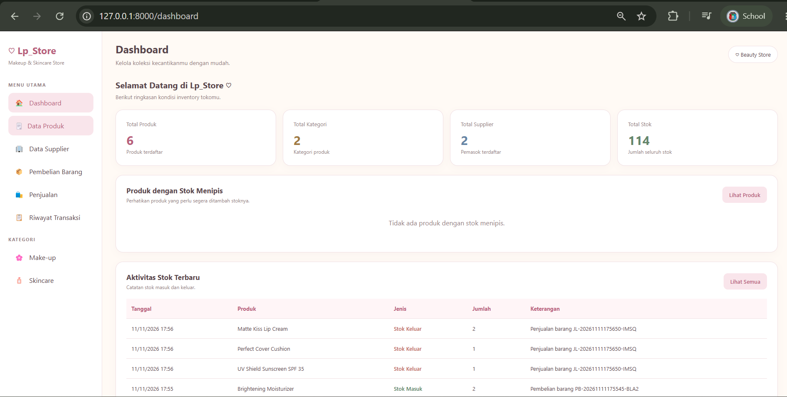
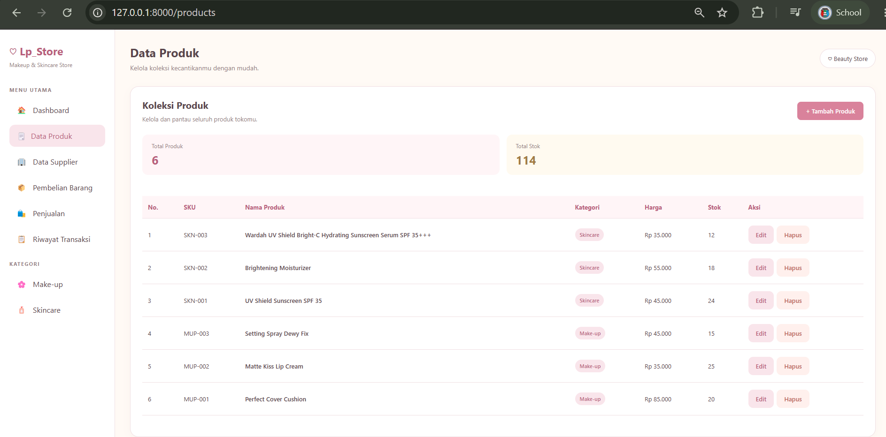
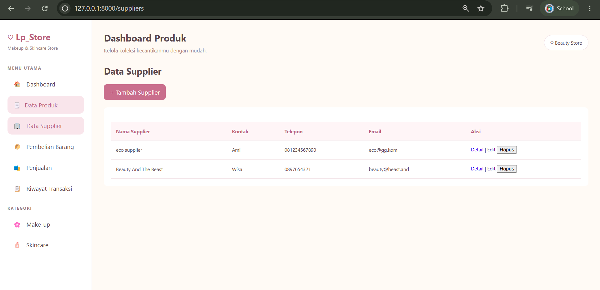
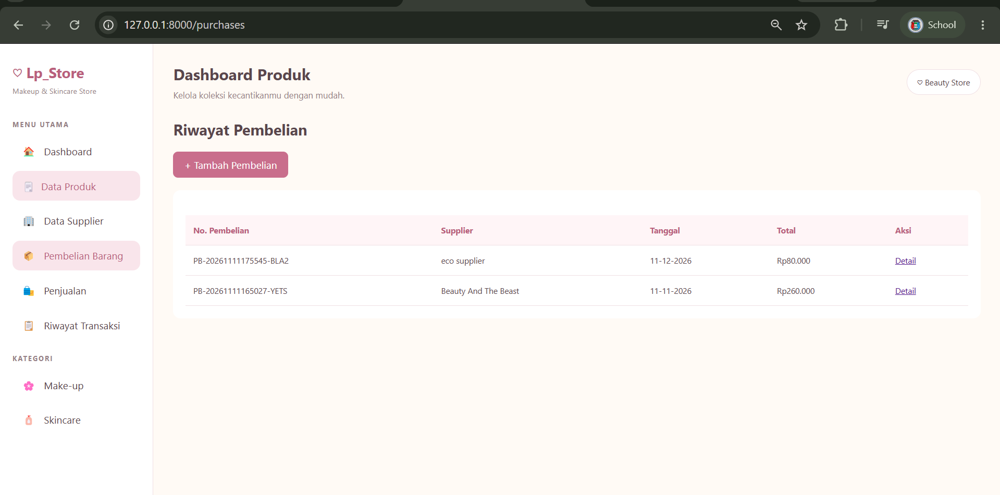
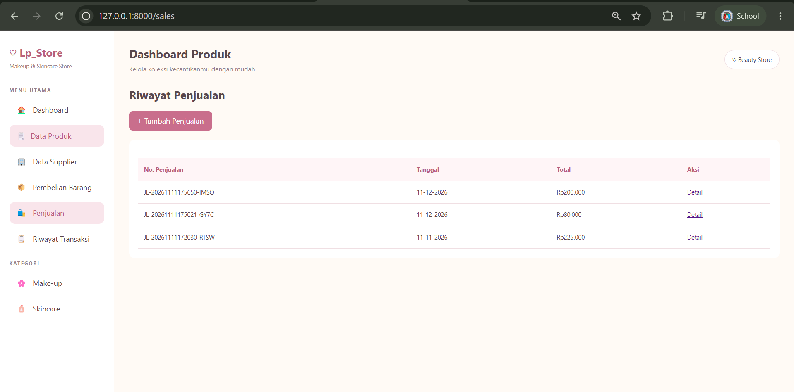

# Inventory Management System

Aplikasi **Inventory Management System** berbasis web yang dikembangkan menggunakan Laravel untuk membantu pengelolaan persediaan barang, transaksi pembelian, penjualan, dan riwayat pergerakan stok.

## Deskripsi

Inventory Management System merupakan aplikasi pengelolaan inventaris yang dirancang untuk mempermudah proses pencatatan dan pemantauan stok barang secara terstruktur.

Aplikasi ini menyediakan pengelolaan data produk, kategori, supplier, pembelian, penjualan, serta riwayat transaksi dan pergerakan stok.

## Fitur Aplikasi

- **Dashboard** – Menampilkan ringkasan informasi inventaris.
- **Manajemen Produk** – Menambah, melihat, mengubah, dan menghapus data produk.
- **Manajemen Kategori** – Mengelola kategori produk Make-up dan Skincare.
- **Manajemen Supplier** – Mengelola data pemasok barang.
- **Pembelian** – Mencatat transaksi pembelian dan penambahan stok.
- **Penjualan** – Mencatat transaksi penjualan dan pengurangan stok.
- **Riwayat Transaksi** – Menampilkan catatan transaksi pembelian dan penjualan.
- **Stock Movements** – Mencatat pergerakan stok barang.

## Teknologi yang Digunakan

- PHP
- Laravel
- MySQL / MariaDB
- HTML
- CSS
- JavaScript
- Bootstrap

## Tampilan Aplikasi

### Dashboard


### Data Produk


### Kategori Make-up


### Kategori Skincare


### Data Supplier


### Transaksi Pembelian


### Transaksi Penjualan


### Riwayat Transaksi


### Form Tambah Produk


### Form Tambah Supplier


### Form Pembelian


### Form Penjualan


## Instalasi dan Menjalankan Aplikasi

1. Clone repository:

   ```bash
   git clone https://github.com/Luthfia0507/Inventory-laravel.git
   ```

2. Masuk ke direktori proyek:

   ```bash
   cd Inventory-laravel
   ```

3. Install dependency Laravel:

   ```bash
   composer install
   ```

4. Salin file konfigurasi:

   ```bash
   copy .env.example .env
   ```

5. Buat database MySQL dengan nama `inventory_db`, kemudian sesuaikan konfigurasi database pada file `.env`.

6. Generate application key:

   ```bash
   php artisan key:generate
   ```

7. Jalankan migration dan seeder:

   ```bash
   php artisan migrate --seed
   ```

8. Install dan build frontend:

   ```bash
   npm install
   npm run build
   ```

9. Jalankan aplikasi:

   ```bash
   php artisan serve
   ```

10. Buka aplikasi melalui browser:

    `http://127.0.0.1:8000`

## Status Pengembangan

Proyek ini masih dalam tahap pengembangan dan penyempurnaan fitur untuk meningkatkan fungsionalitas serta keandalan sistem.

## Repository

GitHub: https://github.com/Luthfia0507/Inventory-laravel